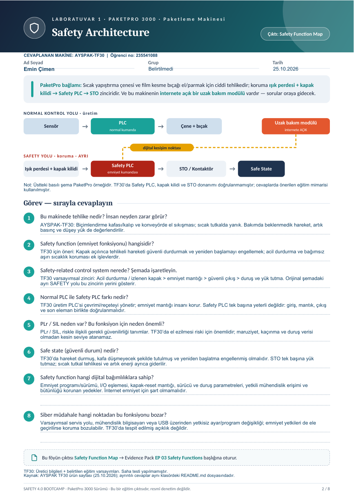
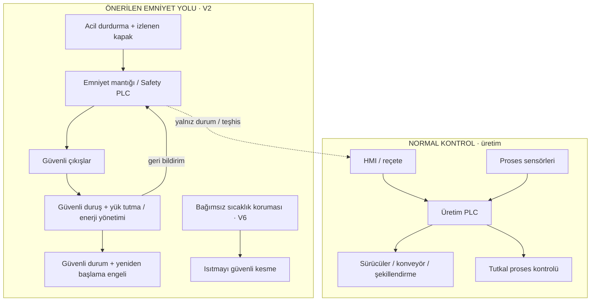

# Laboratuvar 1 · Safety Architecture

**Çıktı:** Safety Function Map · **EP 03 — Safety Functions**

**Makine:** AYSPAK-TF30 · **Hazırlayan:** Emin Çimen · **Öğrenci numarası:** 235541088 · **Tarih:** 25.10.2026

[← Ana sayfa](../README.md) · [Ortak varsayımlar ve kaynaklar](../kaynaklar/makine-ve-varsayimlar.md) · [Sonraki laboratuvar →](../laboratuvar-2/README.md)

## Doldurulmuş orijinal föy

**[Laboratuvar 1 PDF’sini aç / indir](Laboratuvar-1-Doldurulmus-Foy.pdf)**

Orijinal PaketPro 3000 föyünün basılı metinleri ve şemaları korunmuş; boş alanlara **AYSPAK-TF30** için cevaplar eklenmiştir. Emin Çimen / 235541088 bilgileri sayfada yer alır. Orijinal sayfa numarası korunmuştur. Aşağıdaki açıklamalar PDF cevaplarının ayrıntılı sürümüdür.

> Kapsam: Genel föyün sekiz sorusu cevaplanmıştır. Aşağıdaki emniyet zinciri V2 kapsamında önerilen eğitim mimarisidir; gerçek TF30 donanımının tespiti değildir.

## 1. Bu makinede tehlike nedir? İnsan neyden zarar görür?

| Tehlikeli bölge / durum | Maruziyet örneği | Olası fiziksel sonuç |
|---|---|---|
| Biçimlendirme kafası ve kalıp arası | Sıkışan kartona elle müdahale | El/parmak ezilmesi, ciddi sıkışma |
| Konveyör ve hareketli aktarım noktaları | Temizlik veya malzeme düzeltme | Kapılma, sıkışma |
| Sıcak tutkal uygulama bölgesi | Nozul temizliği veya yüzeye temas | Termal yanık |
| Artık enerji / beklenmedik hareket | Bakımda enerji geri gelmesi veya yükün düşmesi | Ezilme, darbe; basınçlı eleman varsa kontrolsüz hareket |

İlk üç tehlike makinenin açıklanan sürecinden çıkarılan değerlendirmelerdir; erişilebilirlik ve şiddet saha ölçümüyle doğrulanmamıştır. Son satırda pnömatik düzenin ayrıntısı ve yük tutma yöntemi ayrıca doğrulanmalıdır. [K1, V1, V3]

## 2. Emniyet fonksiyonu hangisidir?

Ana fonksiyon **SF-01: koruyucu kapak açıldığında tehlikeli hareketi durdurmak ve erişim sürdükçe yeniden başlamayı önlemektir.** Tamamlayıcı fonksiyonlar acil durdurma, beklenmedik yeniden başlatmayı engelleme ve tehlikeli ısınmayı sınırlamadır.

| Kimlik | Tetikleyici | Gerekli güvenli tepki | Yeniden başlatma koşulu |
|---|---|---|---|
| SF-01 | Kapak açma talebi / korumanın açılması | Tehlikeli hareket erişimden önce güvenli duruma geçer; gerekiyorsa duruş bitene kadar kapak kilitli kalır. | Koruma kapalı, hata giderilmiş, yerel manuel reset ve ayrı start |
| SF-02 | Acil durdurma | Riskin gerektirdiği güvenli duruş gerçekleşir; tehlikeli hareket engellenir. | Buton serbest bırakma tek başına başlatmaz; yerel reset ve ayrı start gerekir. |
| SF-03 | Enerji veya iletişimin geri gelmesi | Kendiliğinden hareket başlamaz. | Güvenli koşullar doğrulandıktan sonra ayrı yerel başlatma |
| SF-04 | Güvenli sıcaklık sınırının aşılması | Isıtma kesilir; soğuyana kadar tehlikeli bölgeye erişim önlenir. | Sıcaklık güvenli aralıkta, neden giderilmiş ve yetkili yerel onay |

SF-04 ve ilgili bağımsız sıcaklık koruması V6 kapsamında öneridir. Acil durdurma, koruyucu düzenlerin veya bakımda enerji izolasyonunun yerine geçmez.

## 3. Safety-related control system nerede?

Aşağıdaki alt yol emniyetle ilgili kontrol sistemidir: **emniyet girişi → emniyet mantığı → güvenli çıkış → son eleman ve geri bildirim**. Yalnızca Safety PLC'den oluşmaz; bütün zincir birlikte değerlendirilir.

Şema kavramsaldır. Fren, STO, kontaktör veya valf seçimi gerçek mekanizma ve risk değerlendirmesine bağlıdır. Teşhis bağlantısı emniyet kararını üretim PLC'sine devretmez.

## 4. Normal PLC ile Safety PLC farkı nedir?

Normal PLC üretim sırasını ve reçeteyi yönetir. Emniyet kontrolörü, emniyet işlevleri için uygun hata algılama ve güvenilirlik özellikleriyle seçilir. Normal PLC'ye bir durdurma satırı eklemek tek başına emniyet fonksiyonu oluşturmaz. Safety PLC kullanılması da tüm zincirin otomatik olarak yeterli PL/SIL sağladığını göstermez; giriş, çıkış, yazılım ve son elemanlar birlikte doğrulanmalıdır.

## 5. PLr / SIL neden var? Bu fonksiyon için neden önemli?

PLr, gerekli performans seviyesini; SIL ise ilgili yöntem kapsamında emniyet bütünlük seviyesini ifade eder. Tehlikeli arızaya karşı gereken güvenilirliği riskle ilişkilendirmeye yararlar. SF-01'in çalışmaması elin hareket bölgesinde kalmasına yol açabileceğinden güvenilirlik kritik önemdedir. Yaralanma şiddeti, maruziyet ve kaçınma olanağı ölçülmeden **PLr=d/e veya SIL 2/3 atanmaz**. Laboratuvar 3'ün L×S×E puanı da bu seviyeleri doğrudan vermez.

## 6. Safe state nedir?

Tehlikeli hareket durmuş, biçimlendirme kafası düşmeyecek şekilde tutulmuş, yeniden başlama engellenmiş ve sıcak tutkal tehlikesine erişim kontrol edilmiş olmalıdır. Yalnızca STO uygulamak düşey yükü tutmayı veya sıcak yüzeyi soğutmayı garanti etmez. Duruş ve yük tutma birlikte değerlendirilir. [K6, K7]

Bakım için ayrıca enerji izolasyonu, artık basıncın güvenli yönetimi, mekanik destek ve sıcak yüzeylerin güvenli sıcaklığa gelmesi gerekir. Kontrol devresinin durması bakım izolasyonuyla aynı değildir.

## 7. Emniyet fonksiyonunun dijital bağımlılıkları nelerdir?

Emniyet programı ve doğrulanmış sürümü; giriş/çıkış eşlemesi; kapak ve reset mantığı; güvenli sürücü parametreleri; duruş zamanları; varsa güvenli haberleşme ayarları ve yetkili mühendislik erişimi. Yedeklerin bütünlüğü ve değişiklik sonrası doğrulama kayıtları da önemlidir. İnternet veya bulut bağlantısı emniyetin çalışmasının ön koşulu olmamalıdır.

## 8. Siber müdahale hangi noktadan bu fonksiyonu bozar?

V4 senaryosundaki ele geçirilmiş servis erişimi, mühendislik bilgisayarı veya yetkisiz USB; programı, sürücü ayarlarını ya da emniyet giriş eşlemesini değiştirmeye giriş kapısı olabilir. Üretim reçetesinin değişmesi tehlike yaratabilir; yaralanma zincirinin tamamlanması korumanın da yetersiz kalmasına bağlıdır. Hedef gereksinim, üretim kontrolünün ele geçirilmesinin emniyet işlevlerini susturamamasıdır. Bu senaryolar TF30'da bulunmuş açıklıklar değildir.
