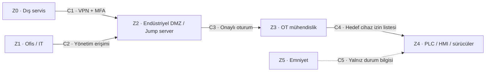

# Laboratuvar 2 · IEC 62443 Mini Workshop

**Çıktı:** Zone / Conduit Diagram · **EP 05 — Zone & Conduit**

**Makine:** AYSPAK-TF30 · **Hazırlayan:** Muhammed Emin Cimen · **Tarih:** 25.10.2026

[← Ana sayfa](../README.md) · [Önceki](../laboratuvar-1/README.md) · [Sonraki →](../laboratuvar-3/README.md)

> Bölgeler benzer risk ve güvenlik ihtiyacına göre ayrılmıştır. Aşağıdaki yapı V3–V5 kapsamında öneridir; mevcut fabrika ağı değildir. Bölge ve conduit yaklaşımı için [IEC özeti](https://syc-se.iec.ch/deliveries/cybersecurity-guidelines/security-standards-and-best-practices/iec-62443/) ve [NIST OT rehberi](https://csrc.nist.gov/pubs/sp/800/82/r3/final) temel alınmıştır.

## Görev A1 · Hangi varlıklar aynı bölgede?

| Bölge | Varlıklar | Gerekçe |
|---|---|---|
| Z0 — Dış servis | Servis personelinin bilgisayarı | Kurum dışında, doğrudan güvenilmeyen kaynak |
| Z1 — Ofis / IT | ERP, e-posta ve ofis bilgisayarları | Üretim kumandasına ihtiyaç duymayan kurumsal varlıklar; varsayımsal çevre |
| Z2 — Endüstriyel DMZ | VPN erişim ağ geçidi, jump server ve oturum kayıt hizmeti | Dış erişimi üretimden ayıran denetimli ara bölge |
| Z3 — OT mühendislik | Yetkili mühendislik istasyonu | Programlama/değişiklik yetkisi nedeniyle rutin operatör erişiminden ayrılır. |
| Z4 — Makine kontrol | Üretim PLC, HMI, sürücüler ve proses I/O | Üretim çevrimini yürüten cihazlar |
| Z5 — Emniyet | Önerilen emniyet kontrolörü, güvenli I/O ve emniyet arayüzleri | İnsan koruma işlevlerini normal üretim erişiminden ayırır. |

Genel föydeki robot kontrolörü ve SCADA istemcisi için TF30'a ait kanıt yoktur; envantere eklenmemiştir. İleride gerçekten bulunurlarsa risklerine göre ayrıca değerlendirilir. Wi-Fi AP, bulut telemetri ve kilitsiz iki USB, PaketPro örneğinin ayrıntılarıdır; TF30 gerçeği olarak taşınmamıştır. USB bir ağ bölgesi değil, ayrıca denetlenmesi gereken fiziksel veri aktarım yoludur.

## Görev A2 · Safety PLC neden Z5'te? Açık bakım modülü kalabilir mi?

Önerilen Safety PLC, emniyet programının üretim reçetesinden daha sıkı korunması gerektiği için Z5'e konulmuştur. VLAN ayırmak tek başına yeterli değildir; erişim kuralları, mühendislik yetkisi, fiziksel koruma ve emniyet doğrulaması birlikte gereklidir.

V4 başlangıç senaryosunda dışarıya doğrudan açık servis modülü Z0'dan Z4'e kontrolsüz bir geçiş oluşturur. Hedefte bu geçiş kaldırılır: servis erişimi Z2'de sonlandırılır, Z3 üzerinden yetkili iş için süreli açılır. Z5'e internetten veya jump server'dan programlama erişimi verilmez.

## Görev A3 · Conduit'ler ve her geçişteki kontrol

| Geçiş | İzin verilen amaç | Denetim |
|---|---|---|
| C1 · Z0 → Z2 | Yetkili servis bağlantısı | VPN, MFA, kişisel hesap, süre sınırı, kaynak kısıtı |
| C2 · Z1 → Z2 | Yetkili erişim yönetimi | Yalnız belirlenmiş yönetici cihazı ve hesap; ofisten OT'ye doğrudan geçiş yok |
| C3 · Z2 → Z3 | Onaylanmış bakım oturumu | İş emri, yerel onay, hedef izin listesi ve oturum kaydı |
| C4 · Z3 → Z4 | İzinli teşhis / onaylı değişiklik | Gerekli servis ve cihazlarla sınırlama; yazma yetkisi ayrı onay; yedek ve değişiklik kaydı |
| C5 · Z5 → Z4 | Emniyet durumunun görüntülenmesi | Yalnız gereken teşhis; üretim yolundan emniyet programı, reset veya bypass komutu yok |

C5 işlevsel veri yönünü gösterir; fiziksel tek yönlü cihaz kurulmuş olduğu iddia edilmez. Protokol oturumları ve güvenlik cihazları uygulamada doğrulanmalıdır. Normal erişim politikasında **açıkça izin verilmeyen geçişler kapalıdır**. Gerçek protokoller bilinmediğinden port numarası uydurulmamıştır.

Emniyet değişikliği C1–C4 servis yolundan yapılmaz. Gerektiğinde ayrı yetkili yerel mühendislik prosedürü; güvenli bakım durumu, sürüm kaydı ve yeniden doğrulama ile uygulanır.

## Görev B · Uzak erişim kararı

| Karar | Seçim | Neden |
|---|---|---|
| Aracı | Jump server | Servis bilgisayarının PLC'ye doğrudan erişimini önlemek ve oturumu denetlemek |
| Tünel | VPN | İletişimin gizliliği ve bütünlüğünü korumak; tek başına yetkilendirme sayılmaz |
| Kimlik | MFA | Yalnız parola ele geçirilmesinin erişim için yeterli olmamasını sağlamak |
| Hesap | Kişisel | Her işlemi sorumlusuyla ilişkilendirmek ve yetkiyi kişi bazında kapatmak |
| Kayıt | Tam oturum kaydı | İşlem, hedef, zaman ve değişiklikleri izlemek; kayıt erişimi ve saklama süresi ayrıca yönetilir |
| Zamanlama | Varsayılan kapalı | İş emri ve yerel onayla açılan, süre sonunda kapanan bakım penceresi oluşturmak |

**Sonuç:** Ofis veya servis hesabının ele geçirilmesi, emniyet bölgesinde otomatik programlama yetkisi kazandırmamalıdır. Z5'in bağımsızlığı Laboratuvar 4'te ölçülebilir gereksinimlere bağlanmıştır.
