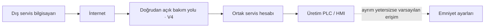
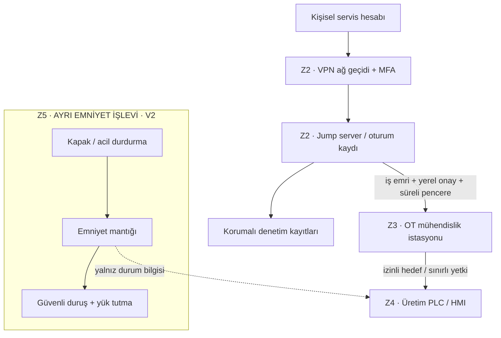

# Laboratuvar 4 · Secure Remote Access

**Çıktı:** Secure Architecture · **EP 02 + EP 06**

**Makine:** AYSPAK-TF30 · **Hazırlayan:** Emin Çimen · **Öğrenci numarası:** 235541088 · **Tarih:** 25.10.2026

[← Ana sayfa](../README.md) · [Önceki](../laboratuvar-3/README.md) · [Kaynaklar ve varsayımlar](../kaynaklar/makine-ve-varsayimlar.md)

> “Mevcut” başlığı föydeki başlangıç durumunu ifade eder. Buradaki mevcut yapı **V4 eğitim varsayımıdır; AYSPAK'ın gerçek ağı veya erişim sistemi hakkında bulgu değildir**. Hedef çizim kavramsaldır. Emniyet köprüsü bölümünde ürün/marka seçmek yerine karşılanacak gereksinimler yazılmıştır.

## Görev A · Mevcut → hedef

### Mevcut: eğitim için tanımlanmış zayıf başlangıç

Bu senaryoda kişisel sorumluluk, süreli onay, ayrıntılı oturum kaydı ve emniyet erişiminin ayrılığı yeterli değildir. Son kesikli ok, gerçek bir bağlantı tespiti değil, Laboratuvar 3 R1'in gerçekleşmesi için gereken zayıflığı gösterir.

### Hedef: denetimli servis yolu ve bağımsız koruma

Dış servis yolundan emniyet programlama/bypass bağlantısı tanımlanmamıştır. Normal üretim erişiminin ele geçirilmesi SF-01–SF-04 işlevlerini değiştirme yetkisi vermemelidir. Böylece erişim güvenliği ve emniyet bağımsızlığı iki ayrı koruma katmanı olur. [K4]

### Beş ilke ile yeniden düzenleme

Föy Görev A'da beş ilke isterken Laboratuvar 2'de altı erişim kararı verir. VPN ve MFA aynı “güçlü giriş” ilkesi altında toplanarak altı karar da korunmuştur.

| İlke | Hedef gereksinim | Kontrol edilecek kanıt |
|---|---|---|
| 1 · Denetimli ara nokta | Dış erişim DMZ ve jump server üzerinden geçmeli; PLC internete doğrudan açılmamalı. | Ağ geçişleri ve kural listesi |
| 2 · Güçlü giriş | Uzak oturum şifreli VPN ve MFA gerektirmeli. | VPN politikası, MFA uygulaması ve kimlik doğrulama kaydı |
| 3 · Kişisel ve sınırlı yetki | Ortak hesap kaldırılmalı; teşhis ve yazma yetkisi ayrılmalı. | Hesap/rol matrisi ve süre sonu yetki iptali |
| 4 · İzlenebilirlik | Oturum, hedef, kullanıcı ve değişiklikler kaydedilmeli; kayıtların yetkisiz silinmesi engellenmeli. | Eşzamanlı zaman damgaları, korumalı kayıt ve değişiklik onayı |
| 5 · Varsayılan kapalı | Bağlantı iş emri, yerel onay ve belirli süreyle açılmalı; süre dolunca kapanmalı. | Bakım penceresi ve otomatik kapanma kaydı |

Mühendislik oturumu başlangıçta salt teşhis yetkisiyle açılır. Üretim programı değişikliği için ayrı onay, güvenli bakım durumu, mevcut sürüm yedeği, etki değerlendirmesi ve değişiklik sonrası işlev doğrulaması gerekir. Oturum kaydı tutulması tek başına emniyet kanıtı değildir.

## Görev B1 · Saldırgan yine de içeri girerse emniyet etkilenir mi?

**Hedef gereksinim karşılanmışsa üretim kontrolü ele geçirilse bile emniyet talebi yerine getirilmelidir.** Kapak koruması, acil durdurma, yeniden başlama engeli ve gerekli sıcaklık koruması uzak bakım komutuyla susturulamamalıdır. Ancak bu bağımsızlık yalnız çizimle garanti edilemez. Ortak mühendislik yetkisi, değiştirilebilir emniyet parametreleri veya korunmamış reset yolu varsa emniyet etkilenebilir. Bu nedenle gerçek cevap, mimari inceleme ve doğrulama kanıtıyla verilmelidir.

## Görev B2 · Emniyetin bağımsızlığı için gereksinim

**Ana gereksinim:** Üretim PLC'si, HMI, mühendislik istasyonu veya uzak bakım oturumu ele geçirilse dahi, emniyet talebi tehlikeli hareketin güvenli duruma geçmesini sağlamalı; uzak yol bu talebi bastıramamalı veya tehlikeli yeniden başlatmaya neden olamamalıdır.

| ID | Gereksinim | Kabul ölçütü / planlanan doğrulama |
|---|---|---|
| G1 | Servis rolü emniyet programını, giriş eşlemesini ve güvenli duruş parametrelerini değiştirememelidir. | Onaylı test ortamında servis hesabıyla değişiklik girişimi reddedilir ve kaydedilir. |
| G2 | Emniyet talebi, normal PLC'nin çalışma durumundan ve dış bağlantının sürekliliğinden bağımsız karşılanmalıdır. | Normal kontrol hatası ve bağlantı kaybı durumlarında SF-01/SF-02 gereği güvenli tepki doğrulanır. |
| G3 | Kapak açılması veya enerji geri gelmesi kendiliğinden yeniden başlatma üretmemelidir. | Kapak kapatma / enerji dönüşü tek başına hareket başlatmaz; yerel reset ve ayrı start gerekir. |
| G4 | Duruş, operatör tehlikeye ulaşmadan tamamlanmalı; düşey kafa güvenli tutulmalıdır. | En kötü koşuldaki duruş süresi ve erişim mesafesi ölçülür; gerekli sınırlar risk değerlendirmesinde belirlenir. |
| G5 | Sıcaklık tehlikesi normal reçete yetkisinden bağımsız sınırlandırılmalıdır. | Kontrollü doğrulamada sınır aşımı güvenli tepki üretir; erişim sıcaklık tehlikesi bitene kadar önlenir. |
| G6 | Emniyet değişikliği yetkili yerel prosedür ve yeniden doğrulama gerektirmelidir. | Sürüm, bütünlük, onay ve doğrulama kayıtları tamamlanmadan üretime dönüş yapılmaz. |

Bunlar istenen davranışlardır; belirli bir Safety PLC, fren veya ağ ürünü zorunlu kılınmamıştır. G1–G6 sahada uygulanmış/test edilmiş değildir. Uygulama kararı ve ayrıntılı tasarım yetkili mühendislik çalışmasına aittir.

## Önceki laboratuvarlarla izlenebilirlik

| Risk | İlgili emniyet işlevi | Bölge / geçiş | Ana gereksinim |
|---|---|---|---|
| R1 · Yetkisiz hareket | SF-01, SF-02 | Z2–Z5, C1–C5 | G1, G2, G4 |
| R2 · Tehlikeli ısınma | SF-04 | Z3–Z4, C4 | G5, G6 |
| R3 · Hatalı geri yükleme / yeniden başlama | SF-03 | Z3 ve yerel yükleme yolu | G3, G6 |

**Laboratuvar çıktısı:** TF30 için varsayımsal başlangıç ile hedef erişim yapısı karşılaştırılmış; altı erişim kararı beş ilkeye yerleştirilmiş; emniyet bağımsızlığı altı doğrulanabilir gereksinimle tanımlanmıştır.
