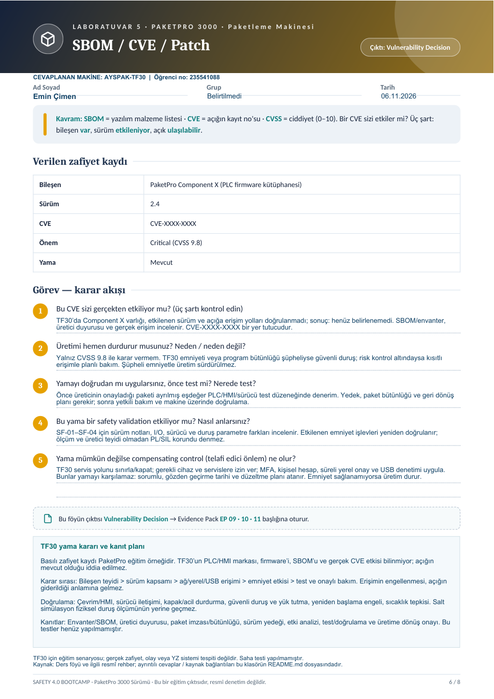

# Laboratuvar 5 · SBOM / CVE / Patch

**Çıktı:** Vulnerability Decision · **EP 09 · 10 · 11**

**Makine:** AYSPAK-TF30 · **Hazırlayan:** Emin Çimen · **Öğrenci numarası:** 235541088 · **Tarih:** 06.11.2026

[← Ana sayfa](../README.md) · [Önceki](../laboratuvar-4/README.md) · [Sonraki →](../laboratuvar-6/README.md)

## Doldurulmuş orijinal föy

**[Laboratuvar 5 PDF’sini aç / indir](Laboratuvar-5-Doldurulmus-Foy.pdf)**

Orijinal PaketPro 3000 sayfasındaki metin, tablo ve sorular korunmuş; boş alanlara **AYSPAK-TF30** cevapları eklenmiştir. Basılı `Component X`, `2.4`, `CVE-XXXX-XXXX` ve `CVSS 9.8` bilgileri eğitim örneğidir; gerçek TF30 bileşeni veya doğrulanmış güvenlik açığı değildir. Mevcut donanım/firmware envanteri ve üretici SBOM’u paylaşılmamıştır.

## 1. Bu CVE gerçekten etkiliyor mu? Üç şartın kontrolü

| Kontrol | TF30 için gereken kanıt | Bu çalışmadaki sonuç |
|---|---|---|
| Bileşen mevcut mu? | PLC/HMI/sürücü envanteri, üretici SBOM’u veya teyidi | Bilinmiyor; Component X’in varlığı kanıtlanmamıştır. |
| Sürüm etkileniyor mu? | Kurulu tam sürüm, üretici güvenlik duyurusu ve etkilenen sürüm aralığı | Bilinmiyor; föydeki 2.4 TF30’da okunmuş bir sürüm değildir. |
| Açık ulaşılabilir mi? | İlgili servis/işlevin etkinliği, erişim yolları ve sömürü ön koşulları | Gerçek ağ/yerel erişim yolları doğrulanmamıştır. Yalnız internet erişimi incelenerek karar verilmez. |

**Karar: Etkilenebilirlik henüz belirlenemedi.** Bileşen veya sürüm kapsam dışıysa gerekçesi kaydedilir. Yalnız ağ erişimini engellemek açığı gidermek sayılmaz; USB, yerel servis ve diğer erişim yolları da değerlendirilir. Yer tutucu CVE gerçek bir zafiyet kaydı olarak aranıp varmış gibi sunulmamıştır.

## 2. Üretimi hemen durdurur musunuz?

**Yalnız 9.8 puanına bakarak otomatik durdurma kararı vermem.** Önce gerçek etkilenebilirlik, aktif müdahale işareti ve emniyet fonksiyonlarının durumu incelenir. Emniyet ayarlarının bütünlüğü şüpheliyse veya güvenli çalışma doğrulanamıyorsa TF30 güvenli duruma alınır, üretim sürdürülmez. Emniyet sağlıklı ve risk denetim altındaysa geçici erişim kısıtlarıyla planlı bakım penceresi hazırlanır; karar ve sorumlusu kaydedilir.

TF30’da güvenli duruş; kafanın düşmesini önleme, yeniden başlamayı engelleme, sıcak tutkal ve varsa artık basıncı yönetme gerektirir. Kontrol bilgisayarını kapatmak tek başına güvenli duruş değildir.

## 3. Yama doğrudan mı, önce test mi? Nerede?

Önce üreticiyle sürüm/donanım uyumluluğu teyit edilir. Üretimden ayrılmış, eşdeğer donanım/firmware ve I/O davranışını temsil eden test düzeneğinde denenir. Salt yazılım simülasyonu fiziksel duruş ölçümünü karşılamaz. Test düzeneği bu çalışmada kurulmamıştır.

1. Onaylı paket, imza/bütünlük kontrolü ve sürüm notları alınır; program, parametre ve geri yükleme yedekleri korunur.
2. Üretim sırası, HMI, sürücü iletişimi, kapak/acil durdurma, yeniden başlama ve sıcaklık tepkileri kontrollü koşullarda doğrulanır.
3. Sonuçlar uygunsa yetkili bakım penceresinde uygulanır; gerçek makinede gerekli doğrulama tamamlanmadan üretime dönülmez.
4. Geri dönüş yalnız güvenilir, uyumlu sürüme ve belgelenmiş risk kararıyla yapılır; eski açık yeniden devreye alınmış sayılır ve ayrıca yönetilir.

## 4. Yama emniyet doğrulamasını etkiler mi?

Firmware’in, I/O eşlemesinin, güvenli iletişimin veya sürücü zamanlamalarının değişmesi SF-01–SF-04 işlevlerini etkileyebilir. Sürüm notu, üretici teyidi ve yapılandırma farkları üzerinden etki analizi yapılır. Yama yalnız HMI’yı etkiliyor olsa bile yetki/reset davranışı incelenir. Gerekli yeniden doğrulamanın kapsamı belgelendirilir; ölçüm olmadan “PL/SIL aynı kaldı” denmez.

## 5. Yama mümkün değilse telafi edici önlem

Doğrudan dış erişim kapatılır; yalnız gerekli cihaz/servislere izin verilir; MFA, kişisel hesap, yerel onay ve süreli bakım uygulanır. İlgili işlev güvenle kapatılabiliyorsa devre dışı bırakılır; USB ve program yükleme yetkisi sınırlandırılır; kayıtlar izlenir. Bunlar açığı düzeltmez. Sorumlu, gözden geçirme tarihi ve yama/değişim planı atanır. Emniyet güvence altına alınamıyorsa üretim durur.

**Kanıt paketi:** Envanter/SBOM teyidi → etki kararı → paket bütünlüğü → test ve emniyet doğrulama kayıtları → onaylı devreye alma. Bu çalışma test sonucu üretmez.

**Kaynak:** [NIST SP 800-82 Rev. 3](https://csrc.nist.gov/pubs/sp/800/82/r3/final), ders föyü s. 6 ve [ortak varsayımlar](../kaynaklar/makine-ve-varsayimlar.md).
