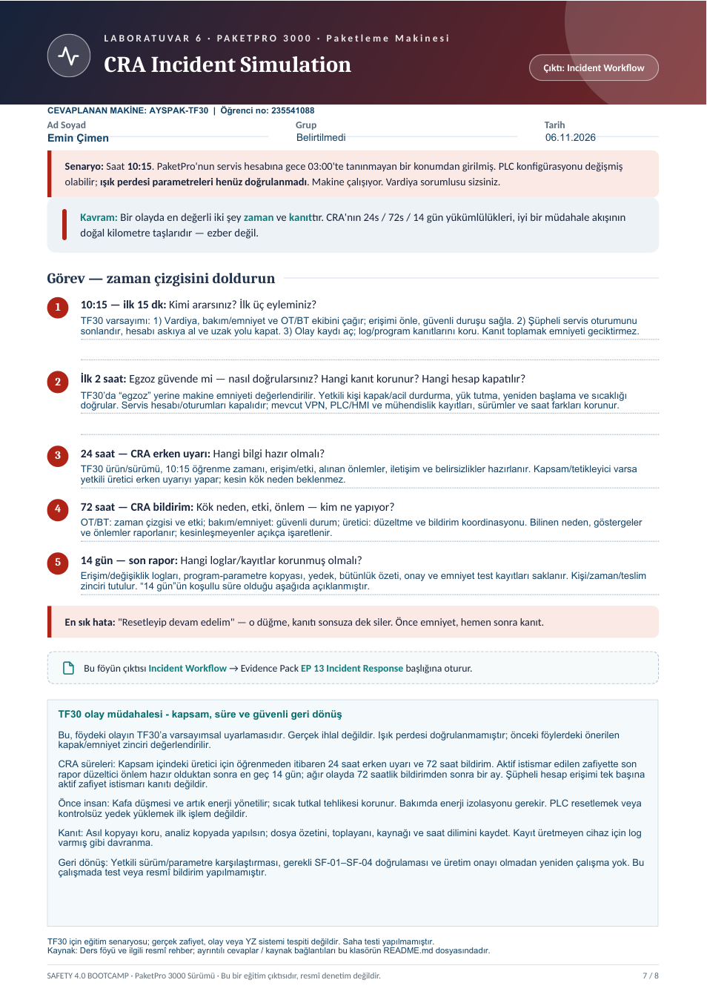

# Laboratuvar 6 · CRA Incident Simulation

**Çıktı:** Incident Workflow · **EP 13 — Incident Response**

**Makine:** AYSPAK-TF30 · **Hazırlayan:** Emin Çimen · **Öğrenci numarası:** 235541088 · **Tarih:** 06.11.2026

[← Ana sayfa](../README.md) · [Önceki](../laboratuvar-5/README.md) · [Sonraki →](../laboratuvar-7/README.md)

## Doldurulmuş orijinal föy

**[Laboratuvar 6 PDF’sini aç / indir](Laboratuvar-6-Doldurulmus-Foy.pdf)**

Senaryo TF30 için varsayımsal olarak ele alınmıştır: 10:15’te servis hesabındaki 03:00 erişimi öğrenilir; PLC programının bütünlüğü şüphelidir. Gerçek AYSPAK olayı değildir. TF30’da ışık perdesi ve uzaktan servis modülü doğrulanmamıştır. Değerlendirme önceki laboratuvarlardaki önerilen kapak/acil durdurma ve bağımsız emniyet zincirine dayanır.

## 1. 10:15–10:30: Kimi ararsınız? İlk üç eylem

Vardiya/üretim sorumlusu, bakım–emniyet yetkilisi ve OT/BT olay müdahale ekibi haberdar edilir; üreticinin yetkili servisi koordinasyona alınır.

1. **İnsanı koru:** Erişimi önle; emniyet bütünlüğü şüpheli TF30’u yetkili prosedürle güvenli duruma al. Kafanın tutulması, sıcak tutkal ve artık enerji dikkate alınır. Fiziksel bakım gerekiyorsa enerji izolasyonu uygulanır.
2. **Erişimi sınırla:** Şüpheli uzak oturumu sonlandır, servis hesabını askıya al, ilgili uzaktan yolu kapat. Emniyet için gerekli haberleşme doğrulanmadan rastgele kablo sökülmez.
3. **Kanıtı koru:** Olay numarası aç; 10:15 öğrenme ve 03:00 erişim zamanlarını saat dilimiyle kaydet; erişim/program kayıtlarını güvenli yöntemle dışa aktar. Kanıt toplamayı beklemek emniyet müdahalesini geciktirmez.

## 2. İlk iki saat: Emniyet, kanıt ve kapatılacak hesap

Föydeki “Egzoz güvende mi?” ifadesi TF30 açısından **makinenin güvenli durumda olduğunun doğrulanması** şeklinde cevaplanmıştır; egzoz donanımı varsayılmamıştır.

Yalnız HMI’daki yeşil durum simgesine güvenilmez. Yetkili personel onaylı sürüm/parametre karşılaştırmasını ve gerekli emniyet kontrollerini yapar. İzlenen kapak, acil durdurma, güvenli duruş/yük tutma, yeniden başlama engeli ve sıcaklık koruması doğrulanmadan üretim açılmaz. İnsan tehlikeli bölgedeyken canlı test yapılmaz.

Servis hesabı ve aktif oturumları kapatılır; aynı kimlik bilgilerini kullanan diğer erişimler araştırılır. Delil kopyasından sonra ilgili sırlar güvenilir cihazdan değiştirilir. VPN/jump server, güvenlik duvarı, HMI/PLC, mühendislik istasyonu ve değişiklik kayıtları toplanır. Her cihazın kayıt kapasitesi bilinmediğinden mevcut olmayan loglar varmış gibi raporlanmaz; eksikler yazılır.

## 3. 24 saat: Erken uyarı için hangi bilgi hazır?

Öğrenme zamanı, ürün/model ve sürüm, kapsam, şüpheli erişim, bilinen fiziksel/işletmesel etki, alınan önlemler, iletişim sorumlusu ve belirsizlikler hazırlanır. Kök neden kesinleşmemişse bu açıkça belirtilir; incelemenin bitmesi beklenmez.

## 4. 72 saat: Etki, neden ve sorumluluklar

| Sorumlu rol | Hazırlayacağı çıktı |
|---|---|
| OT/BT olay ekibi | Zaman çizgisi, erişim yolu, göstergeler, etkilenen varlıklar; doğrulanmış ve şüpheli bulgular ayrımı |
| Bakım/emniyet yetkilisi | SF-01–SF-04 etkisi, fiziksel güvenli durum ve üretime dönüş için gerekli doğrulama |
| Üretici güvenlik/servis ekibi | Firmware ve konfigürasyon analizi, düzeltme/azaltma seçenekleri |
| Yetkili üretici bildirim sorumlusu | Kapsam/tetikleyici değerlendirmesi ve gerekiyorsa resmî bildirim |
| Üretim sorumlusu | Güvenli devreye alma onayı ve işletme koordinasyonu |

Bu roller senaryo önerisidir; AYSPAK’ın gerçek organizasyon yapısı olarak sunulmaz.

## 5. “14 gün” başlığında hangi kayıtlar korunur?

Orijinal erişim ve değişiklik logları, program/parametre kopyaları, sürüm ve bütünlük özetleri, saat farkları, hesap/oturum işlemleri, iletişim ve bildirim kopyaları, yama/geri yükleme kayıtları ve emniyet doğrulama tutanakları korunur. Toplayan kişi, zaman, cihaz, kopyalama yöntemi ve dosya özetiyle teslim zinciri tutulur. Asıl kanıt salt okunur korunur; analiz kopyada yürütülür. Kontrolsüz reset veya eski yedeği hemen yüklemekten kaçınılır.

**Süre notu:** CRA kapsamındaki üretici için erken uyarı/ayrıntılı bildirim süreleri öğrenmeden itibaren 24/72 saattir. Aktif istismar edilen zafiyette son rapor düzeltici önlemin kullanılabilir olmasından sonra en geç 14 gün; ağır olayda 72 saatlik bildirimden sonra bir ay içindedir. Föydeki “14 gün” her olay için ortak süre değildir. Bildirim yükümlülüğü kapsam ve tetikleyiciye bağlıdır; tek bir şüpheli oturum aktif zafiyet istismarını kanıtlamaz. [Avrupa Komisyonu, CRA reporting](https://digital-strategy.ec.europa.eu/en/policies/cra-reporting)

**Kaynak:** Ders föyü s. 7, yukarıdaki resmî açıklama ve [NIST OT rehberi](https://csrc.nist.gov/pubs/sp/800/82/r3/final). Gerçek bir olay veya resmî bildirim gerçekleştirilmemiştir.
