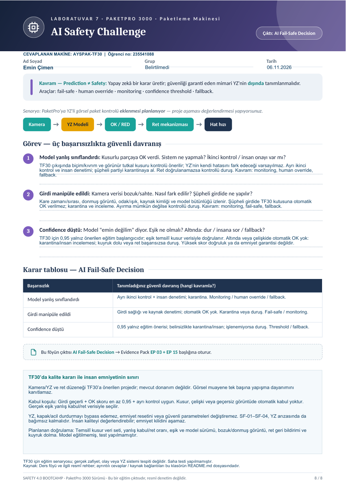

# Laboratuvar 7 · AI Safety Challenge

**Çıktı:** AI Fail-Safe Decision · **EP 03 + EP 15**

**Makine:** AYSPAK-TF30 · **Hazırlayan:** Emin Çimen · **Öğrenci numarası:** 235541088 · **Tarih:** 06.11.2026

[← Ana sayfa](../README.md) · [Önceki](../laboratuvar-6/README.md) · [Ortak varsayımlar](../kaynaklar/makine-ve-varsayimlar.md)

## Doldurulmuş orijinal föy

**[Laboratuvar 7 PDF’sini aç / indir](Laboratuvar-7-Doldurulmus-Foy.pdf)**

TF30 çıkışında kutunun biçimini, kıvrımını ve görünür yapıştırma kusurlarını inceleyen bir kamera/YZ kalite sistemi **proje önerisi** olarak modellenmiştir. Kamera, YZ, ret mekanizması ve ikinci kontrol TF30’da mevcut olduğu doğrulanmış donanımlar değildir. Görsel muayene tek başına tutkalın mekanik yapışma dayanımını kanıtlamaz.

## 1. Model kusurlu kutuya OK verdiğinde ne yapılır?

YZ’nin kendi hatasını her zaman fark edebileceği varsayılmaz. Kritik kalite ölçütleri için YZ’den ayrı ölçüt/kural tabanlı ikinci kontrol; doğrulanmış bir örnekleme planıyla insan kalite denetimi önerilir. Bağımsız kontrol uyumsuzluk bulursa kutu karantinaya ayrılır. Son güvenilir kontrolden beri şüpheli olabilecek parti izlenir ve yeniden değerlendirilir.

Ret işlemi doğrulanamıyorsa veya kuyruk dolarsa yeni kutu beslemesi durdurulur, makine kendi doğrulanmış güvenli duruş prosedürüne geçer. Operatör hareketli kafaya uzanarak ürünü almamalıdır; müdahale güvenli bakım koşullarında yapılır. **Kavramlar:** monitoring, fallback ve human override. İnsan, kalite kararını inceleyebilir; emniyet kilidini bypass edemez.

## 2. Kamera girdisi bozuk veya sahteyse nasıl fark edilir?

Kare zaman damgası/sıra numarası, donmuş görüntü, bağlantı kaybı, aydınlatma/odak ve referans görüntü değişimi izlenir. Kamera kaynak kimliği, erişim yetkisi ve model/konfigürasyon bütünlüğü korunur. Tek başına zaman damgası saldırının yokluğunu garanti etmez.

Girdi güvenilir değilse sistem OK vermez; şüpheli kutular karantinaya alınır. Karantina/ret doğrulanamıyorsa kontrollü duruşa geçilir. YZ’ye dayanmayan görsel insan kontrolü ancak ayrı, güvenli çalışma prosedürü ve onaylı kapasiteyle geçici kalite yöntemi olabilir. Şüpheli kare, model sürümü ve karar kaydı inceleme için korunur. **Kavramlar:** monitoring, fail-safe ve fallback.

## 3. Confidence düştüğünde eşik ve davranış ne olmalı?

Eğitim için **τ = 0,95** başlangıç kabul eşiği önerilmiştir; ölçülmüş, kalibre edilmiş veya sahada onaylanmış bir değer değildir. Yüksek confidence doğruluk veya insan emniyeti garantisi vermez. Gerçek eşik; farklı kutu, ışık, hız ve kusur tiplerini içeren temsilî doğrulama verisiyle, özellikle kusurluya OK verme oranı ve hatanın maliyeti dikkate alınarak belirlenmelidir.

| Koşul | Kalite kararı |
|---|---|
| Kusur kararı | Confidence değerinden bağımsız ret/karantina |
| Geçerli girdi + OK skoru ≥ τ + bağımsız kontrol uygun | Kalite kabulü; emniyet izni anlamına gelmez |
| OK skoru < τ, kontroller arası çelişki veya geçersiz girdi | Otomatik OK yok; ret/karantina ve insan değerlendirmesi |
| Ret doğrulanamadı / karantina dolu / sürekli düşük güven | Yeni beslemeyi kes; doğrulanmış kontrollü duruş ve yetkili inceleme |

## Karar tablosu · AI Fail-Safe Decision

| Başarısızlık | Tanımlanan güvenli davranış | Kavram |
|---|---|---|
| Yanlış sınıflandırma | Bağımsız ikinci kontrol ve insan denetimi; tespit edilen şüpheli partiyi ayır; ret başarısızsa dur. | Monitoring, human override, fallback |
| Manipüle girdi | Kaynak/bütünlük ve kare sağlığı kontrolü; otomatik kabulü kes; karantina veya kontrollü duruş. | Monitoring, fail-safe |
| Düşük confidence | 0,95 yalnız eğitim başlangıcıdır; belirsizlikte insan incelemesi/karantina, işlenemiyorsa duruş. | Confidence threshold, fallback |

## Emniyet sınırı ve gerekli kanıt

YZ kontrolörüne koruyucu kapak, acil durdurma, emniyet reseti veya güvenli hareket parametrelerini değiştirme yetkisi verilmemelidir. YZ yalnız kalite kararını ve tanımlı proses duruş talebini üretir. YZ kesilse veya yanlış OK verse de önerilen SF-01–SF-04 emniyet fonksiyonları bağımsız çalışmalıdır.

Doğrulama planı; örnek veri/etiketler, yanlış kabul-ret oranları, eşik gerekçesi, model sürümü ve bütünlüğü, bozuk/donmuş görüntü denemeleri, ret geri bildirimi, kuyruk dolma ve emniyet bağımsızlığı incelemesini kapsar. **Bunlar önerilen kontrollerdir; model eğitilmemiş ve test sonucu üretilmemiştir.**

**Kaynak:** Ders föyü s. 8 ve [NIST AI RMF 1.0](https://nvlpubs.nist.gov/nistpubs/ai/NIST.AI.100-1.pdf). Eşik ve TF30 uygulama kararları bu çalışmanın önerisidir; kaynakta TF30 için bir eşik tanımlanmaz.
