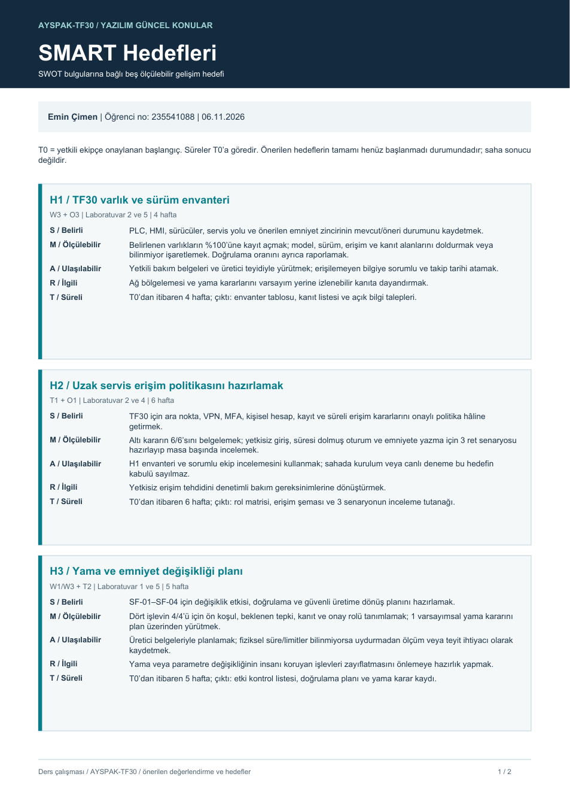
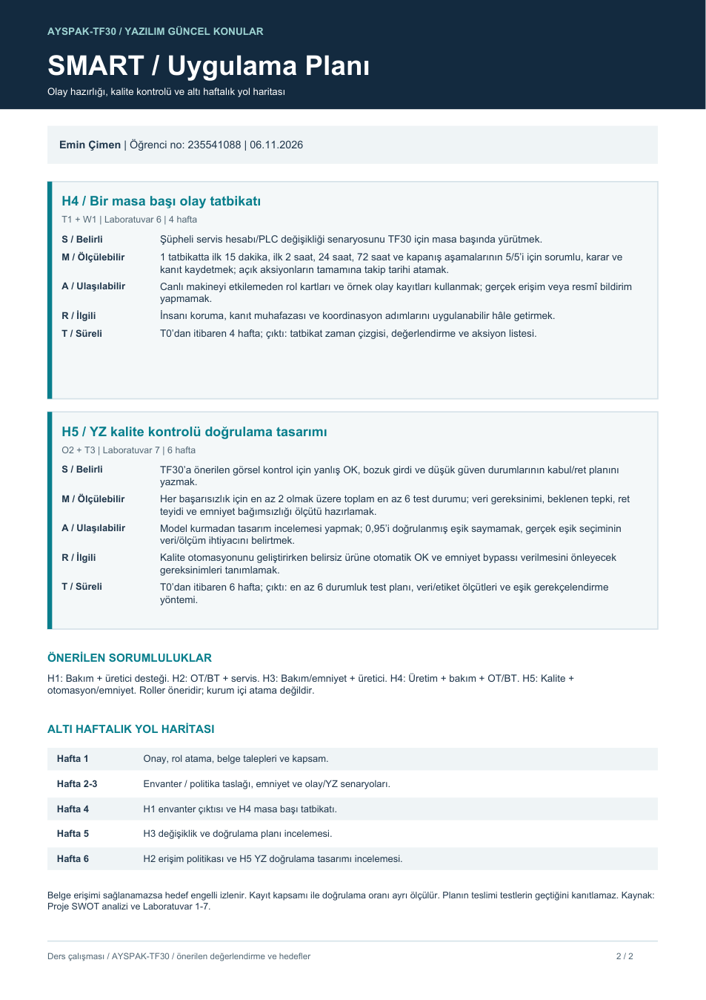

# AYSPAK-TF30 · SMART Hedefleri

**Hazırlayan:** Emin Çimen · **Öğrenci no:** 235541088 · **Tarih:** 06.11.2026

[← Ana sayfa](../README.md) · [SWOT analizi](../swot-analizi/README.md)

**[SMART PDF’sini aç / indir](SMART-Hedefleri.pdf)**

SMART: Belirli (S), ölçülebilir (M), ulaşılabilir (A), ilgili (R), süreli (T).

T0, yetkili ekip tarafından onaylanan plan başlangıcıdır; rapor tarihi otomatik başlangıç değildir. Hedefler öneridir; gerçekleşme durumu: henüz başlanmadı. Belge/üretici erişimi sağlanamazsa ilgili hedef engelli olarak izlenir, tamamlandı sayılmaz.

## H1 · TF30 varlık ve sürüm envanteri

**Önerilen sorumlu:** Bakım sorumlusu + üretici teknik desteği  
**Dayanak:** W3 + O3 | Laboratuvar 2 ve 5

| Ölçüt | TF30 hedefi |
|---|---|
| S | PLC, HMI, sürücüler, servis yolu ve önerilen emniyet zincirinin mevcut/öneri durumunu kaydetmek. |
| M | Belirlenen varlıkların %100’üne kayıt açmak; model, sürüm, erişim ve kanıt alanlarını doldurmak veya bilinmiyor işaretlemek. Doğrulama oranını ayrıca raporlamak. |
| A | Yetkili bakım belgeleri ve üretici teyidiyle yürütmek; erişilemeyen bilgiye sorumlu ve takip tarihi atamak. |
| R | Ağ bölgelemesi ve yama kararlarını varsayım yerine izlenebilir kanıta dayandırmak. |
| T | T0’dan itibaren 4 hafta; çıktı: envanter tablosu, kanıt listesi ve açık bilgi talepleri. |

## H2 · Uzak servis erişim politikasını hazırlamak

**Önerilen sorumlu:** OT/BT sorumlusu + yetkili servis  
**Dayanak:** T1 + O1 | Laboratuvar 2 ve 4

| Ölçüt | TF30 hedefi |
|---|---|
| S | TF30 için ara nokta, VPN, MFA, kişisel hesap, kayıt ve süreli erişim kararlarını onaylı politika hâline getirmek. |
| M | Altı kararın 6/6’sını belgelemek; yetkisiz giriş, süresi dolmuş oturum ve emniyete yazma için 3 ret senaryosu hazırlayıp masa başında incelemek. |
| A | H1 envanteri ve sorumlu ekip incelemesini kullanmak; sahada kurulum veya canlı deneme bu hedefin kabulü sayılmaz. |
| R | Yetkisiz erişim tehdidini denetimli bakım gereksinimlerine dönüştürmek. |
| T | T0’dan itibaren 6 hafta; çıktı: rol matrisi, erişim şeması ve 3 senaryonun inceleme tutanağı. |

## H3 · Yama ve emniyet değişikliği planı

**Önerilen sorumlu:** Bakım/emniyet yetkilisi + üretici  
**Dayanak:** W1/W3 + T2 | Laboratuvar 1 ve 5

| Ölçüt | TF30 hedefi |
|---|---|
| S | SF-01–SF-04 için değişiklik etkisi, doğrulama ve güvenli üretime dönüş planını hazırlamak. |
| M | Dört işlevin 4/4’ü için ön koşul, beklenen tepki, kanıt ve onay rolü tanımlamak; 1 varsayımsal yama kararını plan üzerinden yürütmek. |
| A | Üretici belgeleriyle planlamak; fiziksel süre/limitler bilinmiyorsa uydurmadan ölçüm veya teyit ihtiyacı olarak kaydetmek. |
| R | Yama veya parametre değişikliğinin insanı koruyan işlevleri zayıflatmasını önlemeye hazırlık yapmak. |
| T | T0’dan itibaren 5 hafta; çıktı: etki kontrol listesi, doğrulama planı ve yama karar kaydı. |

## H4 · Bir masa başı olay tatbikatı

**Önerilen sorumlu:** Üretim + bakım/emniyet + OT/BT rolleri  
**Dayanak:** T1 + W1 | Laboratuvar 6

| Ölçüt | TF30 hedefi |
|---|---|
| S | Şüpheli servis hesabı/PLC değişikliği senaryosunu TF30 için masa başında yürütmek. |
| M | 1 tatbikatta ilk 15 dakika, ilk 2 saat, 24 saat, 72 saat ve kapanış aşamalarının 5/5’i için sorumlu, karar ve kanıt kaydetmek; açık aksiyonların tamamına takip tarihi atamak. |
| A | Canlı makineyi etkilemeden rol kartları ve örnek olay kayıtları kullanmak; gerçek erişim veya resmî bildirim yapmamak. |
| R | İnsanı koruma, kanıt muhafazası ve koordinasyon adımlarını uygulanabilir hâle getirmek. |
| T | T0’dan itibaren 4 hafta; çıktı: tatbikat zaman çizgisi, değerlendirme ve aksiyon listesi. |

## H5 · YZ kalite kontrolü doğrulama tasarımı

**Önerilen sorumlu:** Kalite sorumlusu + otomasyon/emniyet rolleri  
**Dayanak:** O2 + T3 | Laboratuvar 7

| Ölçüt | TF30 hedefi |
|---|---|
| S | TF30’a önerilen görsel kontrol için yanlış OK, bozuk girdi ve düşük güven durumlarının kabul/ret planını yazmak. |
| M | Her başarısızlık için en az 2 olmak üzere toplam en az 6 test durumu; veri gereksinimi, beklenen tepki, ret teyidi ve emniyet bağımsızlığı ölçütü hazırlamak. |
| A | Model kurmadan tasarım incelemesi yapmak; 0,95’i doğrulanmış eşik saymamak, gerçek eşik seçiminin veri/ölçüm ihtiyacını belirtmek. |
| R | Kalite otomasyonunu geliştirirken belirsiz ürüne otomatik OK ve emniyet bypassı verilmesini önleyecek gereksinimleri tanımlamak. |
| T | T0’dan itibaren 6 hafta; çıktı: en az 6 durumluk test planı, veri/etiket ölçütleri ve eşik gerekçelendirme yöntemi. |

## Altı haftalık yol haritası

| Dönem | Önerilen iş |
|---|---|
| Hafta 1 | T0/onay, rol atama, belge talepleri ve kapsam |
| Hafta 2 | Envanter kayıtları, erişim politikası ve emniyet planı taslakları |
| Hafta 3 | Eksik veri takibi, olay ve YZ test senaryolarının hazırlanması |
| Hafta 4 | H1 envanter çıktısı ve H4 masa başı tatbikatı |
| Hafta 5 | H3 değişiklik ve doğrulama planının incelenmesi |
| Hafta 6 | H2 erişim politikası ve H5 YZ doğrulama tasarımının incelenmesi |

Kayıt kapsamı, doğrulanan bilgi oranından ayrı izlenir. Planın teslimi makinenin güvenli olduğunu veya testlerin geçtiğini kanıtlamaz. Gerçek kurulum ve fiziksel doğrulama yetkili ekibin ayrı çalışmasıdır.

**Kaynak:** Hedefler bu çalışma için oluşturulmuştur; [SWOT değerlendirmesi](../swot-analizi/README.md) ve Laboratuvar 1–7 ile ilişkilidir.

