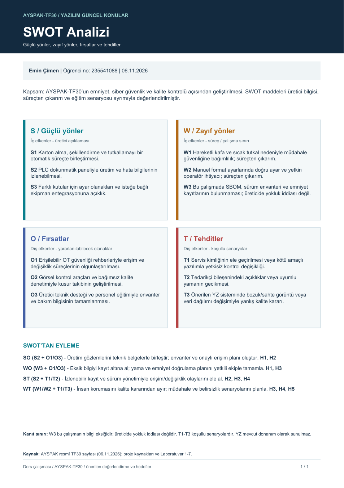

# AYSPAK-TF30 · SWOT Analizi

**Hazırlayan:** Emin Çimen · **Öğrenci no:** 235541088 · **Tarih:** 06.11.2026

[← Ana sayfa](../README.md) · [SMART hedefleri →](../smart-hedefler/README.md)

**[SWOT PDF’sini aç / indir](SWOT-Analizi.pdf)**

Kapsam: AYSPAK-TF30’un emniyet, siber güvenlik ve kalite kontrolü açısından geliştirilmesi. SWOT maddeleri üretici bilgisi, süreçten çıkarım ve eğitim senaryosu ayrımıyla değerlendirilmiştir.

## S · Güçlü yönler

İç etkenler - üretici açıklaması

- **S1:** Karton alma, şekillendirme ve tutkallamayı bir otomatik süreçte birleştirmesi.
- **S2:** PLC dokunmatik paneliyle üretim ve hata bilgilerinin izlenebilmesi.
- **S3:** Farklı kutular için ayar olanakları ve isteğe bağlı ekipman entegrasyonuna açıklık.

## W · Zayıf yönler

İç etkenler - süreç / çalışma sınırı

- **W1:** Hareketli kafa ve sıcak tutkal nedeniyle müdahale güvenliğine bağımlılık; süreçten çıkarım.
- **W2:** Manuel format ayarlarında doğru ayar ve yetkin operatör ihtiyacı; süreçten çıkarım.
- **W3:** Bu çalışmada SBOM, sürüm envanteri ve emniyet kayıtlarının bulunmaması; üreticide yokluk iddiası değil.

## O · Fırsatlar

Dış etkenler - yararlanılabilecek olanaklar

- **O1:** Erişilebilir OT güvenliği rehberleriyle erişim ve değişiklik süreçlerinin olgunlaştırılması.
- **O2:** Görsel kontrol araçları ve bağımsız kalite denetimiyle kusur takibinin geliştirilmesi.
- **O3:** Üretici teknik desteği ve personel eğitimiyle envanter ve bakım bilgisinin tamamlanması.

## T · Tehditler

Dış etkenler - koşullu senaryolar

- **T1:** Servis kimliğinin ele geçirilmesi veya kötü amaçlı yazılımla yetkisiz kontrol değişikliği.
- **T2:** Tedarikçi bileşenindeki açıklıklar veya uyumlu yamanın gecikmesi.
- **T3:** Önerilen YZ sisteminde bozuk/sahte görüntü veya veri dağılımı değişimiyle yanlış kalite kararı.

## SWOT’tan stratejiye

| Strateji | Dayanak | Yapılacak çalışma | SMART hedef |
|---|---|---|---|
| SO | S2 + O1/O3 | Üretim gözlemlerini teknik belgelerle birleştir; envanter ve onaylı erişim planı oluştur. | H1, H2 |
| WO | W3 + O1/O3 | Eksik bilgiyi kayıt altına al; yama ve emniyet doğrulama planını yetkili ekiple tamamla. | H1, H3 |
| ST | S2 + T1/T2 | İzlenebilir kayıt ve sürüm yönetimiyle erişim/değişiklik olaylarını ele al. | H2, H3, H4 |
| WT | W1/W2 + T1/T3 | İnsan korumasını kalite kararından ayır; müdahale ve belirsizlik senaryolarını planla. | H3, H4, H5 |

W3 bu öğrenci çalışmasının bilgi eksikliğidir; üreticinin belge tutmadığı anlamına gelmez. T1–T3 doğrulanmış olay değil koşullu tehdit senaryolarıdır. O2 ve H5’teki YZ sistemi mevcut TF30 donanımı olarak sunulmaz.

**Kaynak:** [AYSPAK resmî TF30 sayfası](https://www.ayspak.com.tr/tr/u/kutulama-makinalari/kutu-yapma-tava-tipi-makinesi), erişim 06.11.2026; [ortak varsayımlar](../kaynaklar/makine-ve-varsayimlar.md) ve Laboratuvar 1–7. S1–S3 üretici açıklamasına dayanır; W1/W2 ve stratejiler bu çalışmanın değerlendirmesidir.

